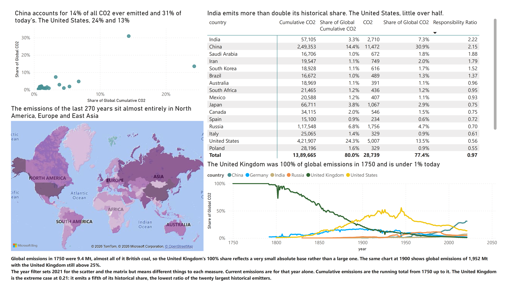
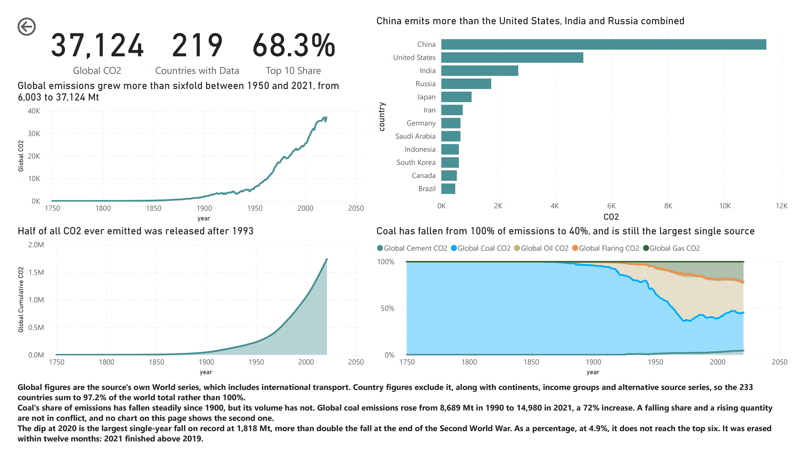
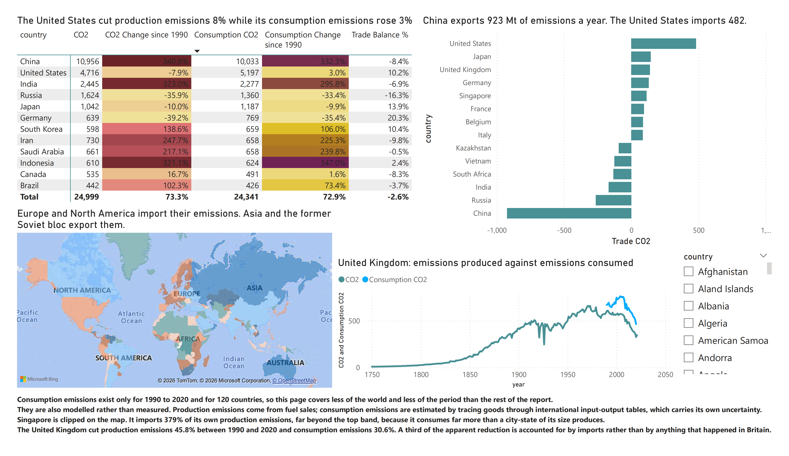
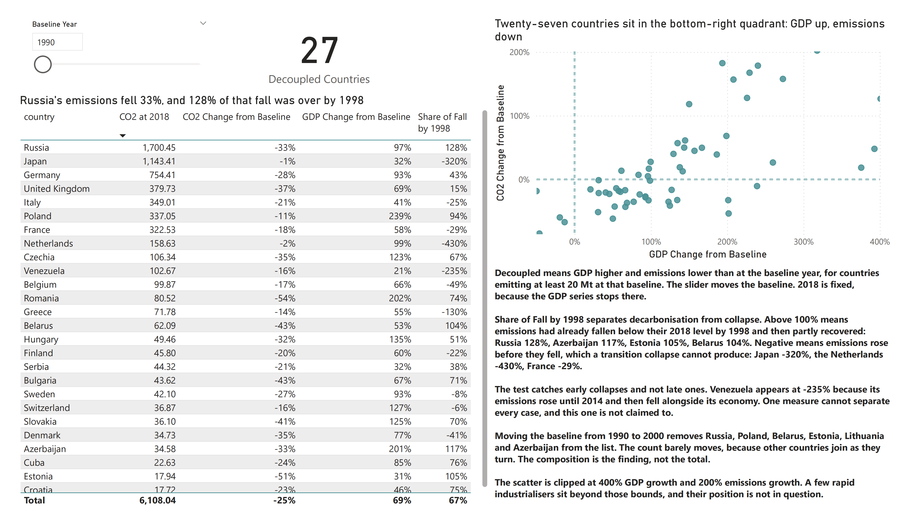
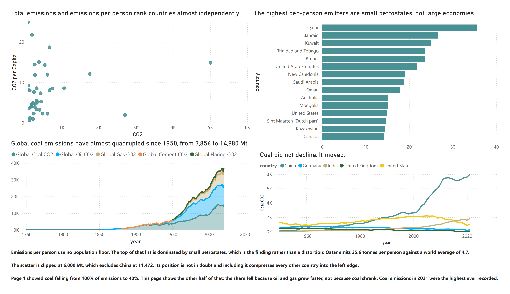

# Global CO2 emissions: 270 years of fossil fuel data

A five-page Power BI report on 50,598 rows of emissions data covering 1750 to
2021, built around three questions that turn out to be one argument: who caused
the problem, whether today's reductions are real or relocated, and whether
anyone has broken the link between growth and emissions.

## Headline findings

- More than half of all CO2 ever emitted was released after 1990. The halfway point of 270 years of industrialisation falls in 1993. [The long view](#1-the-long-view)
- China accounts for 14% of all emissions ever and 31% of today's. The United States, 24% and 13%. [Responsibility](#2-responsibility)
- The United Kingdom was 100% of global emissions in 1750 and is under 1% today. [Responsibility](#2-responsibility)
- The United States cut production emissions 8% since 1990 and increased consumption emissions 3%. A third of Britain's larger reduction is imports rather than anything that happened in Britain. [Trade](#3-trade)
- Twenty-seven countries grew their economies while cutting emissions. Six of them are post-Soviet states whose decline was over by 1998. [Decoupling](#4-decoupling)
- Coal's share of emissions fell from 100% to 40%. Its volume almost quadrupled. Both are true. [Per capita and fuel](#5-per-capita-and-fuel)

---

## Business questions

1. How have global emissions changed since 1750?
2. Who emits most today, and how concentrated is it?
3. Who has emitted most cumulatively, and how different is that league table?
4. How has the largest emitter changed over time?
5. Which countries import their emissions, and which export them?
6. Does counting consumption rather than production change who has decarbonised?
7. Has any country grown its economy while cutting emissions?
8. How much of that decoupling survives a later baseline?
9. How do emissions per person compare with national totals?
10. Has coal actually declined?

---

## Data

**Source:** [Our World in Data, CO2 and Greenhouse Gas Emissions](https://ourworldindata.org/co2-emissions)
**Licence:** CC BY 4.0
**Rows:** 50,598 · **Columns:** 79 · **Period:** 1750 to 2021

Place `visualizing_global_co2_data.csv` in `data/`. It is not committed here.

### Coverage is the binding constraint

The columns do not all span 1750 to 2021, and the report's structure follows
from that rather than from preference.

| Column | Years | Countries |
|---|---|---:|
| `co2`, `cumulative_co2` | 1750 to 2021 | 221 |
| `land_use_change_co2` | 1850 to 2021 | 212 |
| `gdp` | 1820 to 2018 | 165 |
| `primary_energy_consumption` | 1965 to 2021 | 215 |
| `consumption_co2`, `trade_co2` | 1990 to 2020 | 120 |
| `total_ghg`, `methane` | 1990 to 2019 | 193 |

So the trade page covers 1990 to 2020 and 120 countries, and the decoupling page
ends in 2018. Neither pretends otherwise.

### The aggregate rows, and why the obvious rule is wrong

16.7% of rows have a blank `iso_code`. The obvious reading is that these are
aggregates and should be excluded. That rule deletes a country and keeps a
duplicate.

The 46 entities with no ISO code are six different kinds of thing:

| Kind | Entities | Rows |
|---|---:|---:|
| World | 1 | 272 |
| Regions and unions | 12 | 3,222 |
| Income and economic groups | 4 | 1,088 |
| Alternative source series, `(GCP)` and `(Jones et al. 2023)` | 27 | 3,532 |
| International transport | 1 | 171 |
| **Kosovo, an actual country** | 1 | 171 |

Kosovo has no ISO code in this file and has 14 years of emissions data and a
population of 1.66 million. A blank-code rule removes it silently.

The `(GCP)` variants are not duplicates either. Europe and South America match
their plain versions to within rounding, but Asia differs by up to 2,718 Mt and
North America by 186. They are different series with different groupings, so
using both double counts.

And the regions overlap each other. `Europe`, `European Union (27)`,
`European Union (28)`, `Europe (excl. EU-27)` and `Europe (excl. EU-28)` all
coexist, as do `Asia` and `Asia (excl. China and India)`. Only the six
continents form a partition, which the model flags with an `is_continent`
column.

### One check that validates all of it

The six continents plus International transport sum to World at **37,123.9 Mt in
2021, matching to the decimal**.

So the continent partition is exact, country coverage is complete, and aviation
and shipping bunkers are the only component belonging to no country. That last
point explains why the 233 countries sum to 97.2% of the world rather than 100%.

---

## Model

Three tables.

| Table | Rows | Contents |
|---|---:|---|
| `Emissions` | 50,598 | One row per entity-year, 22 columns |
| `Country` | 278 | Entity lookup with `entity_type` and `is_continent` |
| `Year` | 272 | Year and decade |

Plus `_Measures`, holding all 40 measures, and a `Baseline Year` parameter table
for the decoupling page.

### Wide, not unpivoted

79 columns could be unpivoted into 3.8 million rows with a metric slicer driving
one generic measure. It sounds elegant and produces a worse report: every
measure then needs a filter on a metric name, and no formula can combine two
metrics. `DIVIDE(SUM(co2), SUM(population))` becomes awkward for nothing gained.

### 22 columns kept of 79

The columns are three different kinds of thing and mixing them is the trap this
dataset sets.

Base quantities like `co2`, `coal_co2`, `population` and `gdp` are additive.
Summing them across countries means something.

The `*_per_capita` columns are not. Averaging Qatar's 35.6 tonnes per person and
China's 8.0 gives 21.8, which describes nobody.

The `share_global_*` columns are not either, which the original project stub
missed. Germany's 1.8% and China's 30.9% do not average to 16.4% of anything.

So the fact table keeps the additive columns and every ratio comes back as a
measure. Full definitions in [`docs/measures.md`](./docs/measures.md).

### The aggregates stay in the fact table

`Emissions` holds every row including World, the continents and the income
groups, because World is the authoritative global series back to 1750 and
International transport is 2.8% of emissions belonging to nobody.

What makes that safe is a report-level filter on `Country[entity_type] = Country`
plus a naming convention: a `Global` prefix means the measure uses `ALL(Country)`
to read the World row regardless of the filter.

Without the filter, a card showing emissions per person reads 7.51 tonnes rather
than 4.6, because it divides a planet counted several times over by a population
counted several times over, and the two inflations do not cancel.

---

## Findings

### 1. The long view

Global emissions grew from 9.4 Mt in 1750 to 37,124 Mt in 2021, more than
sixfold since 1950 alone.

**More than half of all CO2 ever emitted was released after 1990**, and 97.4%
after 1900. The halfway point of 270 years of industrialisation falls in 1993.

Three countries produce more than half of today's emissions and the top ten
produce 68.3%. China alone emits more than the United States, India and Russia
combined.

The 2020 dip is the largest single-year fall on record at 1,818 Mt, more than
double the fall at the end of the Second World War. As a percentage, at 4.9%, it
does not reach the top six. It was erased within twelve months: 2021 finished
above 2019.

### 2. Responsibility

Cumulative and current emissions produce almost unrelated league tables.

| Country | Share of all emissions ever | Share of 2021 | Ratio |
|---|---:|---:|---:|
| India | 3.3% | 7.3% | 2.22 |
| China | 14.4% | 30.9% | 2.15 |
| Japan | 3.8% | 2.9% | 0.75 |
| Russia | 6.8% | 4.7% | 0.70 |
| United States | 24.3% | 13.5% | 0.56 |
| Germany | 5.4% | 1.8% | 0.34 |
| United Kingdom | 4.5% | 0.9% | 0.21 |

That ratio column was built to compare two shares. It sorts the table almost
exactly by date of industrialisation, which nobody designed it to do.

The share-over-time chart shows three handovers. **The United Kingdom was 100%
of global emissions in 1750**, the United States peaked near 45% around the
Second World War, and China crossed the United States in the mid-2000s. Nobody
has held the top position for more than a human lifetime.

The 100% figure needs its context: global emissions in 1750 were 9.4 Mt, almost
all British coal, so it reflects a very small absolute base. By 1900 global
emissions were 1,952 Mt and the United Kingdom was still above 25%.

### 3. Trade

Production emissions are what a country releases. Consumption emissions are what
its consumption causes, wherever that happens. The two tell different stories
about the same countries.

| Country | Production, 1990 to 2020 | Consumption |
|---|---:|---:|
| United Kingdom | -45.8% | -30.6% |
| Germany | -39.2% | -35.4% |
| France | -28.8% | -23.8% |
| Japan | -10.0% | -9.9% |
| **United States** | **-7.9%** | **+3.0%** |

Japan and Germany's reductions are nearly identical on both measures, so theirs
are real. **A third of Britain's larger reduction is accounted for by imports.**
And the United States cut what it produced while increasing what it consumed.

In 2020 the United States was a net importer of 482 Mt of embodied emissions,
Japan 145, the United Kingdom 138 (42% of its own production again) and Singapore
113 (379%). China was a net exporter of 923 Mt, Russia 264 and India 168.

Two caveats carry weight here. These figures exist only for 1990 to 2020 and 120
countries. And consumption emissions are modelled rather than measured:
production comes from fuel sales, consumption is estimated by tracing goods
through international input-output tables.

### 4. Decoupling

Twenty-seven countries emitting at least 20 Mt in 1990 had, by 2018, grown GDP
and cut emissions. More than I expected, and the list does not survive
inspection intact.

The page carries a baseline slider from 1990 to 2010 so a reader can move it and
watch the composition change.

`Share of Fall by 1998` asks how much of a country's decline had already
happened by 1998.

| | Share of the fall complete by 1998 |
|---|---:|
| Russia | 128% |
| Azerbaijan | 117% |
| Estonia | 105% |
| Belarus | 104% |
| Poland | 94% |
| Germany | 43% |
| United Kingdom | 15% |
| France | -29% |
| Japan | -320% |

Above 100% means emissions had already fallen below their 2018 level by 1998 and
then partly recovered, which is what a collapsing economy looks like. Negative
means emissions rose before they fell, which a transition collapse cannot
produce.

Moving the baseline to 2000 removes Russia, Poland, Belarus, Estonia, Lithuania
and Azerbaijan from the list entirely.

**The count barely moves: 27 at a 1990 baseline, 27 at 2000, 32 at 2010.** That
was not the prediction. Countries leave the list and others join as they turn,
and part of the rise is mechanical, since emissions have less room to grow over
eight years than over twenty-eight. The composition is the finding; the total is
not.

The test catches early collapses and not late ones. Venezuela returns -235%
because its emissions rose until 2014 and then fell with its economy. One
measure cannot separate every case.

### 5. Per capita and fuel

Total emissions and emissions per person rank countries almost independently.
The highest per-person emitters are small petrostates: Qatar at 35.6 tonnes,
Bahrain 26.5, Kuwait 24.6, against a world average of 4.7. The United States
sits twelfth at 14.9. India is the third largest emitter in absolute terms and
near the bottom per person at 1.9.

No population floor is applied, deliberately. That the list is dominated by small
states is the finding rather than a distortion.

**Coal's share of global emissions has fallen from 100% to 40%. Its volume has
almost quadrupled since 1950, from 3,856 Mt to 14,980.** Both statements are
true. The share fell because oil and gas grew faster, not because coal shrank,
and coal emissions in 2021 were the highest ever recorded.

By country, coal did not decline so much as move. United States coal emissions
have halved since the 1970s and British coal has reached the floor, while China's
rose almost vertically after 2000 and India's climbs steadily.

---

## Assumptions and limitations

**Aggregates are in the data and filtered, not deleted.** World, the continents
and the income groups remain in `Emissions`. A report-level filter on
`entity_type` keeps country-level visuals honest, and the `Global` measures read
the World row deliberately.

**Countries means countries and territories.** The 232 ISO-coded entities
include the Falkland Islands, Niue and Montserrat. Kosovo is included as a
country despite having no ISO code.

**Countries sum to 97.2% of the world, not 100%.** International transport, 1,022
Mt in 2021, belongs to no country.

**GDP is purchasing power parity**, in international dollars, not market
exchange rates. Every intensity figure inherits that.

**Consumption emissions are modelled**, not measured, and exist only for 1990 to
2020 across 120 countries.

**2018 is the endpoint of the decoupling page** because the GDP series stops
there, and it is hard-coded into the measures rather than filtered, so the page
cannot silently answer for a different year.

**Decoupling here means GDP up and emissions down**, for countries emitting at
least 20 Mt at the baseline. It says nothing about whether the reduction was
large enough, fast enough, or caused by policy.

**Correlation, not causation, throughout.** This data records emissions,
population, output and trade. It does not record energy policy, carbon pricing,
industrial structure or what any government did.

---

## Files

| Path | Contents |
|---|---|
| `report/global-co2-emissions.pbip` | Power BI project file |
| `report/*.SemanticModel/definition/` | Model as TMDL, readable DAX |
| `report/*.Report/definition/` | Report as PBIR, one file per visual |
| `docs/measures.md` | All 40 measures with their reasoning |
| `images/` | Page screenshots |

Saved as `.pbip` rather than `.pbix` so the model and report are text that
GitHub can display and diff.
